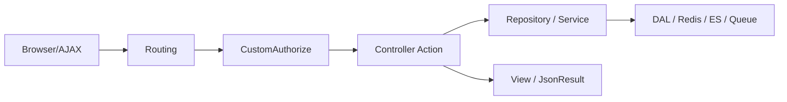
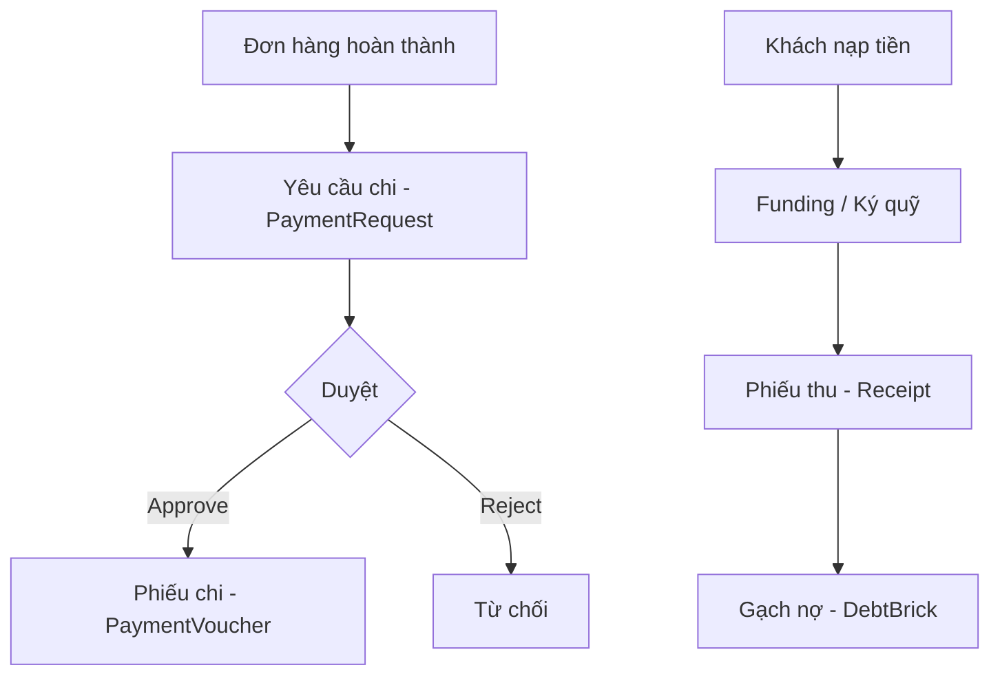

# Tài liệu bàn code — Tầng Controller (WEB.CMS)

Tài liệu này mô tả tầng **Controller** của hệ thống CMS Adavigo, gồm 74 file controller trong `WEB.CMS/Controllers`, nhóm theo nghiệp vụ và luồng xử lý chung.

---

## 1. Tổng quan kiến trúc

### 1.1. Cấu trúc solution

| Layer | Project | Vai trò |
|---|---|---|
| Presentation | `WEB.CMS` | Controller, View, ViewComponent, Service |
| Business | `Repositories` | Repository pattern, gọi DAL |
| Data Access | `DAL` | Truy vấn SQL |
| Domain | `Entities` | Model, ViewModel |
| Shared | `Utilities`, `Caching` | Helper, Redis, constant |

### 1.2. Luồng request cơ bản



- **Routing:** Convention `{controller}/{action}/{id?}` + một số route tùy chỉnh trong `Program.cs`
- **Controller** nhận request → gọi **Repository** → trả **View** (HTML) hoặc **JsonResult** (AJAX)
- **ManagementUser** lấy user hiện tại, quyền menu từ Redis/DB

### 1.3. Đặc điểm Controller layer

| Hạng mục | Chi tiết |
|---|---|
| Base class | Tất cả kế thừa `Controller` (ASP.NET Core MVC) |
| Xác thực | `[CustomAuthorize]` trên từng controller (không global filter) |
| Partial class | `OrderController` (2 file), `PricePolicyController` (3 file), `SetServiceController` (5 file) |
| Namespace | Trộn `WEB.CMS.Controllers`, `WEB.Adavigo.CMS.Controllers`, `CMS.Controllers` |
| DI | Repository inject qua constructor; một số tạo trực tiếp `*ESRepository`, `WorkQueueClient` |

---

## 2. Authentication & Authorization

### 2.1. Đăng nhập — `AccountController`

| Action | Mô tả |
|---|---|
| `Login` / `ConfirmLogin` | Form đăng nhập, tạo cookie auth |
| `LoginWithToken` | `[Route("login/token/{token_user}")]` — SSO/token |
| `CheckIfUserLogged` | Kiểm tra session |
| `Setup2FA` / `OTPTest` / `Confirm2FA` / `SendOTP` | Luồng MFA 2 bước |
| `Logout` / `RedirectLogin` | Đăng xuất, chuyển trang login |

**Cấu hình cookie** (`Program.cs`):
- Timeout: 60 phút, `SlidingExpiration = true`
- Login path: `/Account/RedirectLogin`

### 2.2. `CustomAuthorize`

```15:52:WEB.CMS/Customize/CustomAuthorize.cs
    public class CustomAuthorize : CustomAttribute, IAuthorizationFilter
    {
        public void OnAuthorization(AuthorizationFilterContext context)
        {
            // ...
            if (!isAuthenticated)
            {
                context.Result = new RedirectResult("/Account/RedirectLogin");
            }
        }
    }
```

- Chưa đăng nhập → redirect `/Account/RedirectLogin`
- Action có `[AllowAnonymous]` → bỏ qua kiểm tra
- **Phân quyền menu** do `MenuViewComponent` + `ManagementUser.GetCurrentUser().Permissions` xử lý, không nằm trong filter

### 2.3. Quản lý user & role

| Controller | Chức năng chính |
|---|---|
| `UserController` | CRUD user, đổi mật khẩu, reset MFA, QR code, gán role |
| `RoleController` | CRUD role, gán user, cấu hình permission theo menu |
| `MFAManagementController` | Quản lý/test OTP 2FA |
| `Configs/MenuController` | CRUD menu, phân quyền menu, thông báo |
| `Configs/DepartmentController` | CRUD phòng ban |

---

## 3. Custom Routing quan trọng

Định nghĩa trong `Program.cs`:

| URL | Controller.Action |
|---|---|
| `/Order/{id?}` | `Order.Orderdetails` |
| `/Apartment/{id?}` | `Apartment.Orderdetails` *(controller đang comment)* |
| `SetService/fly/detail/{group_booking_id}` | `SetService.FlyDetail` |
| `SetService/Tour/Detail/{id}` | `SetService.TourDetail` |
| `SetService/Others/Detail/{id}` | `SetService.OtherDetail` |
| `SetService/VinWonder/Detail/{id}` | `SetService.VinWonderDetail` |
| `/Account/2FA` | `Account.Setup2FA` |
| `/RequestHotelBooking/Detail/{hotel_booking_id}/{ClientId}/{id}` | `RequestHotelBooking.Detail` |
| `/transactionsms` | `TransactionSms.Index` |

---

## 4. Pattern chung trên Controller

| Pattern | Mô tả | Ví dụ |
|---|---|---|
| `Index()` | Trang danh sách | Hầu hết module |
| `Search(...)` | Tìm kiếm/phân trang AJAX | Order, Funding, Report |
| `AddOrUpdate(id)` | Form thêm/sửa | User, Hotel, Supplier |
| `AddJson` / `Update` / `UpSert` | Lưu POST JSON | Funding, Invoice |
| `Detail(id)` | Chi tiết | Order, Contract |
| `ExportExcel(...)` | Xuất Excel | Order, Report, Funding |
| `*Suggestion(...)` | Autocomplete AJAX | OrderManual, Contract |
| `Approve` / `Reject` / `Delete` | Luồng duyệt | PaymentRequest, InvoiceRequest |
| `CountStatus(...)` | Đếm theo trạng thái (badge tab) | PaymentRequest, Funding |
| `SendEmail` / `ConfirmSendEmail` | Gửi email dịch vụ | Order, SetService |
| SSE stream | Real-time qua Redis | `SseController`, `CommentController` |

---

## 5. Chi tiết theo module nghiệp vụ

### 5.1. Dashboard & Hệ thống

| Controller | Actions chính | Ghi chú |
|---|---|---|
| `HomeController` | `Index`, `DataMonitor`, `ExecuteQuery` | Dashboard đơn hàng gần đây |
| `DashBoardController` | `GetRevenueOrderByDay`, `GetOrderStatistic`, `GetListTransferSms`… | API chart cho dashboard kế toán |
| `AllCodeController` | CRUD danh mục hệ thống (AllCode) | Dùng chung nhiều module |
| `LocationController` | `LoadProvince/District/Ward`, CRUD địa điểm | Cache Redis |
| `ElasticController` | `PushToQueue` | Đẩy job sync Elasticsearch qua RabbitMQ |
| `NoteController` | `CommentList`, `UpSert`, `Delete` | Ghi chú inline |
| `AttachFileController` | `UploadFile`, `Widget` | Upload file/ảnh |
| `ErrorController` | `Index`, `AjaxAuthenticate` | Trang lỗi |
| `BotTelegramController` | Quản lý bot Telegram | Log/notify |

---

### 5.2. Đơn hàng — `OrderController` (partial, ~38 actions)

**File:** `OrderController.cs` + `Order/OrderManualController.cs`

| Nhóm | Actions |
|---|---|
| Danh sách | `Index`, `Search`, `ExportExcel` |
| Chi tiết | `Orderdetails`, `ClientDetail`, `Packages`, `ContractPay`, `BillVAT`, `ListPassenger`, `PersonInCharge` |
| Cập nhật | `UpdateOrderStatus`, `UpdateOrder`, `UpdateOrderFinishPayment`, `UpdateOrderIsLock`, `UpdateOrderCutOffDate` |
| Dịch vụ | `DeleteService`, `CancelService`, `RePushOrderServiceToOperator` |
| Email | `SendEmail`, `ConfirmSendEmail`, `SendEmailCode` |
| Popup/AJAX | `PopupAddSale`, `PopupFly`, `PopupOrderStatus`, `ReCreateOrder` |
| Suggest | `GetSuggestion`, `OrderNoSuggestion`, `BoongKingCodeSuggestion` |

#### Tạo đơn thủ công — `OrderManualController`

Hỗ trợ 5 loại dịch vụ:

| Loại | Actions chính |
|---|---|
| Hotel | `AddHotelService*`, `SummitHotelServiceData` |
| Fly | `AddFlyBookingService*`, `SummitFlyBookingServiceData` |
| Tour | `AddTourService*`, `SummitTourServiceData` |
| Other | `AddOtherService*`, `SummitOtherServicePackages` |
| VinWonder | `AddVinWonderService*`, `SummitVinWonderServicePackages` |

Utility: `ClientSuggestion`, `HotelSuggestion`, `ChangeOrderSaler`, `GetGuestFromFile`

#### Module Order khác

| Controller | Chức năng |
|---|---|
| `Order/SupplierController` | CRUD nhà cung cấp (NCC), payment, contact, service, export đơn theo loại |
| `Order/RequestHotelBookingController` | Yêu cầu booking KS: duyệt, comment, cập nhật trạng thái |
| `Order/DebtGuaranteeController` | Bảo lãnh nợ: list, detail, update status, export |

---

### 5.3. Vận hành dịch vụ — `SetService/` (5 partial files)

Cùng class `SetServiceController`, tách theo loại dịch vụ:

| File | Loại dịch vụ | Actions tiêu biểu |
|---|---|---|
| `SetServiceController.cs` | **Hotel** | `SetServiceHotel`, `Search`, `HotelServiceDetai`, `ListHotelServicesOrder`, `UpdateHotelBooking`, `SendEmail*`, `ExportExcel` |
| `SetServiceFlyBookingController.cs` | **Vé máy bay** | `Fly`, `FlySearch`, `FlyDetail`, `UpdateServiceCode`, `DeclineFlyBooking`, `SendServiceCode`, `ChangeToConfirmPaymentStatus` |
| `SetServiceTourController.cs` | **Tour** | `Tour`, `TourDetail`, `ListTourPackages`, `UpdateTourStatus`, `SummitTourService`, `TourExportExcel` |
| `SetServiceOtherController.cs` | **Dịch vụ khác** | `Others`, `OtherDetail`, `GrantOtherServiceOrderPermission`, `OtherExportExcel` |
| `SetServiceVinWonderController.cs` | **VinWonder** | `VinWonder`, `VinWonderDetail`, `ExportVinWonderTicket`, `EmailVinWonderTicket` |
| `TourProductController.cs` | Sản phẩm tour | CRUD tour product, giá, endpoint |

**Luồng vận hành chung:** Danh sách → Chi tiết → Gán operator → Cập nhật giá → Gửi mã dịch vụ → Xác nhận thanh toán → Export

---

### 5.4. Tài chính — `Funding/` (6 controllers)

| Controller | Nghiệp vụ | Actions chính |
|---|---|---|
| `FundingController` | Nạp tiền/ký quỹ | `Search`, `CountStatus`, `Approve`, `Reject`, `AddContractPay`, `ExportExcel` |
| `ReceiptController` | Phiếu thu | CRUD phiếu thu, lấy đơn/ký quỹ/dịch vụ theo khách/NCC |
| `PaymentRequestController` | Yêu cầu chi (YC chi) | CRUD, `Approve/Reject`, lấy gói dịch vụ theo loại, `AddPaymentVoucher`, `InYCChi` |
| `PaymentVoucherController` | Phiếu chi | CRUD, `SendEmail`, `GetRequestBySupplierId/ClientId`, `ExportExcel` |
| `DebtStatisticController` | Thống kê công nợ | CRUD, duyệt/từ chối, lịch sử, export |
| `DebtBrickController` | Gạch nợ | Gạch nợ theo đơn/phiếu thu, undo, history, export |

**Luồng tài chính:**



---

### 5.5. Hóa đơn — `Invoice/`

| Controller | Chức năng |
|---|---|
| `InvoiceRequestController` | Yêu cầu xuất HĐ: CRUD, duyệt/từ chối, export, history |
| `InvoiceController` | Hóa đơn đã xuất: CRUD, liên kết yêu cầu HĐ |

---

### 5.6. Báo cáo — `Report/` (7 controllers)

| Controller | Nội dung báo cáo |
|---|---|
| `ReportOrderController` | Báo cáo đơn hàng |
| `ReportClientDebtController` | Công nợ khách hàng (detail + export) |
| `ReportHotelRevenueController` | Doanh thu khách sạn |
| `ReportEmployeeRevenueController` | Doanh thu nhân viên |
| `ReportDepartmentController` | Doanh thu theo phòng ban/sale/NCC/operator (~19 actions) |
| `ReportSupplierController` | Báo cáo NCC |
| `ApartmentReportController` | Báo cáo căn hộ |

Pattern chung: `Index` → `Search` → `ExportExcel`

---

### 5.7. Khách hàng & CRM

| Controller | Chức năng |
|---|---|
| `CustomerManagerController` | Quản lý khách B2B: list, detail, lịch sử nạp tiền, đơn hàng, hợp đồng |
| `CustomerManagerManualController` | CRM thủ công: lead, import Excel, comment, upload |
| `FundCustomerCareController` | Quỹ chăm sóc khách hàng |
| `ClientController` | `ClientSuggestion` — autocomplete khách (dùng chung) |
| `ContractController` | Hợp đồng: CRUD, policy, reset status, suggest khách/hợp đồng |

---

### 5.8. Sản phẩm & Chính sách giá

| Controller | Chức năng |
|---|---|
| `HotelController` | CRUD khách sạn: phòng, phụ thu, tài khoản NH, cổ đông, liên hệ, import Excel |
| `HotelRoomFundController` | Quỹ phòng KS |
| `UserReserveHotelRoomFundController` | NV giữ quỹ phòng: reserve, quick order manual |
| `PolicyController` | Chính sách thanh toán |
| `PricePolicyController` (partial) | Chính sách giá campaign |
| `PriceFlyTicketController` | Chính sách giá vé máy bay |
| `PriceRoomPolicyController` | Chính sách giá phòng KS |
| `VinWonderPolicyController` | Chính sách VinWonder, import giá |
| `GroupProductController` | Nhóm sản phẩm, campaign, position |
| `TourDepartureController` | Ngày khởi hành tour |
| `QuotationController` | Báo giá: CRUD, gửi email, đổi trạng thái |

---

### 5.9. Marketing & Chương trình

| Controller | Chức năng |
|---|---|
| `Programs/ProgramsController` | Chương trình khuyến mãi |
| `Programs/ProgramsPackageController` | Gói giá chương trình, giá phòng theo ngày |
| `FlashSale/FlashSaleController` | Flash sale sản phẩm |
| `NewsController` | Tin bài CMS, fanpage images |
| `RecruitmentController` | Tuyển dụng |
| `playground/playgroundController` | Sân chơi/sản phẩm giải trí |

---

### 5.10. Kho vé & Giao dịch

| Controller | Chức năng |
|---|---|
| `FlightWarehouseController` | Kho vé: search, hold ticket, import Excel |
| `FlightWarehouseHoldTicketController` | Vé giữ: quick order manual |
| `TransactionSmsController` | SMS chuyển khoản, dashboard kế toán |
| `PaymentAccountController` | Tài khoản thanh toán, user agent |
| `ApartmentPaymentController` | Thanh toán căn hộ |
| `CloseTheBook/CloseTheBookController` | Chốt sổ đơn hàng theo năm |

---

### 5.11. Real-time & Tiện ích

| Controller | Cơ chế | Mô tả |
|---|---|---|
| `Notify/SseController` | SSE + Redis pub/sub | `getNotify` — thông báo real-time theo user |
| `Comment/CommentController` | SSE + Redis | `GetCommentsStream` — comment real-time |
| `Tickets/TicketsController` | QR ticket | Tạo/quét vé, `Scan` và `MarkAsUsed` cho phép anonymous |

---

## 6. Controller lớn — ưu tiên đọc khi bàn giao

| Controller | Ước tính dòng | Lý do |
|---|---:|---|
| `OrderController` | ~2800+ | Trung tâm nghiệp vụ đơn hàng |
| `SetServiceController` | ~2100+ | Vận hành 5 loại dịch vụ |
| `PaymentRequestController` | ~1700+ | Luồng YC chi phức tạp |
| `ReportDepartmentController` | ~1800+ | Nhiều loại báo cáo export |
| `CustomerManagerManualController` | ~30 actions | CRM thủ công đa tính năng |

---

## 7. Dependencies thường gặp

| Dependency | Vai trò |
|---|---|
| `ManagementUser` | User hiện tại, quyền, phòng ban |
| `IOrderRepository` | Đơn hàng |
| `IClientRepository` | Khách hàng |
| `IAllCodeRepository` | Danh mục hệ thống |
| `*ESRepository` | Elasticsearch search |
| `WorkQueueClient` | RabbitMQ queue |
| `RedisConn` | Cache, pub/sub SSE |
| `APIService` | Gọi API ngoài |
| `CommentService` | Comment nghiệp vụ |

---
